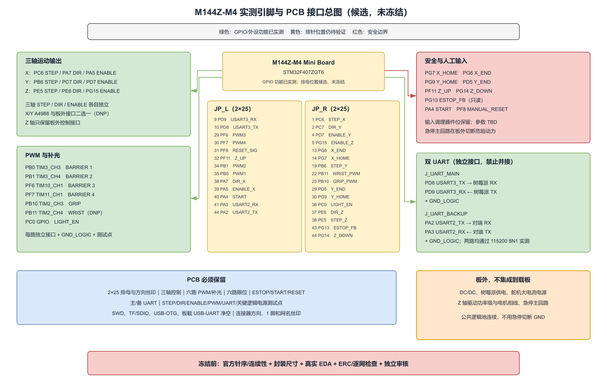

# M144Z-M4 实测引脚与 PCB 接口总图

> 状态：GPIO/定时器/UART 功能映射已按 2026-08-16 基线冻结；`JP_L/JP_R` 排针物理位置、EDA 网络和 PCB 仍为候选，尚未完成官方资料或万用表连续性验证。
>
> 正式通信使用 `PD8/PD9 = USART3`；`PA2/PA3 = USART2` 仅作备用。两个 UART 均须带独立 `GND_LOGIC`，禁止并接 TX/RX。

可编辑源文件：[m144z-m4-tested-pin-pcb-map.drawio](./m144z-m4-tested-pin-pcb-map.drawio)

## 3. 可导入原理图符号与完整针位资料

本图对应的 G1 候选导入包已单独生成：

- [M144Z-M4_CARRIER_IMPORT_README.md](./M144Z-M4_CARRIER_IMPORT_README.md)：立创 EDA/KiCad 导入说明与证据边界
- [M144Z-M4_CARRIER.lib](./M144Z-M4_CARRIER.lib)：Legacy KiCad/立创 EDA 兼容符号库
- [M144Z-M4_CARRIER.kicad_sym](./M144Z-M4_CARRIER.kicad_sym)：KiCad 新版符号库
- [M144Z-M4_CARRIER_pinmap.csv](./M144Z-M4_CARRIER_pinmap.csv)：100 个物理针位逐针表
- [M144Z-M4_CARRIER_pinmap.svg](./M144Z-M4_CARRIER_pinmap.svg)：完整可视针位图
- [G1候选原理图绘制清单-供电更新版.xlsx](./G1候选原理图绘制清单-供电更新版.xlsx)：绘制清单 + 完整物理针位 + 导入文件 + 供电选择页

库中的两个符号名称为 `M144Z_M4_JP_L` 和 `M144Z_M4_JP_R`。针号直接采用各自排针的 1~50 号，奇数是外列、偶数是内列。

## 1. 唯一引脚映射

| PCB 网名 | STM32 功能 | GPIO | M144Z-M4 排针候选位置 | PCB 去向 | 实测状态 |
|---|---|---|---|---|---|
| STEP_X | TIM8_CH1 | PC6 | JP_R-1 | X 驱动 STEP + TP_STEP_X | PWM/联动通过 |
| DIR_X | GPIO 输出 | PA7 | JP_L-38 | X 驱动 DIR + TP_DIR_X | 输出翻转通过 |
| ENABLE_X | GPIO 输出，低有效 | PA5 | JP_L-39 | X 驱动 ENABLE + TP_ENABLE_X | 联动通过 |
| STEP_Y | TIM4_CH1 | PB6 | JP_R-19 | Y 驱动 STEP + TP_STEP_Y | PWM/联动通过 |
| DIR_Y | GPIO 输出 | PC7 | JP_R-2 | Y 驱动 DIR + TP_DIR_Y | 输出翻转通过 |
| ENABLE_Y | GPIO 输出，低有效 | PD7 | JP_R-4 | Y 驱动 ENABLE + TP_ENABLE_Y | 联动通过 |
| STEP_Z | TIM9_CH1 | PE5 | JP_R-38 | J_DRV_Z_CTRL.STEP + TP_STEP_Z | 弃用（Z 轴改舵机，TIM9 保留未用） |
| DIR_Z | GPIO 输出 | PE6 | JP_R-37 | J_DRV_Z_CTRL.DIR + TP_DIR_Z | 弃用（Z 轴改舵机） |
| ENABLE_Z | GPIO 输出，低有效 | PG15 | JP_R-5 | J_DRV_Z_CTRL.ENABLE + TP_ENABLE_Z | 弃用（Z 轴改舵机） |
| BARRIER_PWM_1 | TIM3_CH3 | PB0 | JP_L-35 | J_BARRIER_CTRL_1 + TP | PWM 通过 |
| BARRIER_PWM_2 | TIM3_CH4 | PB1 | JP_L-34 | J_BARRIER_CTRL_2 + TP | PWM 通过 |
| BARRIER_PWM_3 | TIM10_CH1 | PF6 | JP_L-29 | J_BARRIER_CTRL_3 + TP | PWM 通过 |
| BARRIER_PWM_4 | TIM11_CH1 | PF7 | JP_L-30 | J_BARRIER_CTRL_4 + TP | PWM 通过 |
| GRIP_PWM | TIM2_CH3 | PB10 | JP_R-23 | J_GRIPPER_CTRL + TP | PWM 通过 |
| WRIST_PWM | TIM2_CH4 | PB11 | JP_R-22 | J_WRIST_CTRL + TP | 改作 Z 轴舵机信号（复用 TIM2_CH4/PB11） |
| LIGHT_EN | GPIO 输出 | PC0 | JP_R-36 | J_LIGHT + TP_LIGHT_EN | 输出翻转通过 |
| X_HOME | GPIO 输入，外部 10k 上拉，MCU NOPULL | PG7 | JP_R-14 | J_X_HOME | 低有效；历史输入/停步联动通过 |
| X_END | GPIO 输入，外部 10k 上拉，MCU NOPULL | PG6 | JP_R-13 | J_X_END | 低有效；历史输入读取通过 |
| Y_HOME | GPIO 输入，外部 10k 上拉，MCU NOPULL | PG9 | JP_R-30 | J_Y_HOME | 低有效；历史输入/停步联动通过 |
| Y_END | GPIO 输入，外部 10k 上拉，MCU NOPULL | PD5 | JP_R-29 | J_Y_END | 低有效；历史输入读取通过 |
| Z_UP | GPIO 输入，外部 10k 上拉，MCU NOPULL | PF11 | JP_L-32 | J_Z_UP | 低有效；历史双限位联动通过 |
| Z_DOWN | GPIO 输入，外部 10k 上拉，MCU NOPULL | PG14 | JP_R-44 | J_Z_DOWN | 低有效；历史双限位联动通过 |
| ESTOP_FB | GPIO 输入，外部 10k 上拉，MCU NOPULL | PG13 | JP_R-43 | J_ESTOP_FB，只读 | 低有效；仅辅助反馈 |
| START_SIG | GPIO 输入，外部 10k 上拉，MCU NOPULL | PA4 | JP_L-40 | J_START | 低有效；历史输入读取通过 |
| MANUAL_RESET_SIG | GPIO 输入，外部 10k 上拉，MCU NOPULL | PF8 | JP_L-31 | J_MANUAL_RESET | 低有效；历史输入读取通过 |
| UART_MAIN_TX | USART3_TX | PD8 | JP_L-10 | J_UART_MAIN.RX 对端 | 115200 8N1 发送通过 |
| UART_MAIN_RX | USART3_RX | PD9 | JP_L-9 | J_UART_MAIN.TX 对端 | 115200 8N1 回显通过 |
| UART_BACKUP_TX | USART2_TX | PA2 | JP_L-44 | J_UART_BACKUP.RX 对端 | 115200 8N1 发送通过 |
| UART_BACKUP_RX | USART2_RX | PA3 | JP_L-41 | J_UART_BACKUP.TX 对端 | 115200 8N1 回显通过 |

## 2. PCB 必须放置

- `JP_L_SOCKET`、`JP_R_SOCKET`：2x25 排母；丝印必须标 TF 卡方向、外列/内列、1 脚和 `PC6/PC7`。
- X/Y：A4988 候选插座与板外驱动接口二选一，均默认 DNP，禁止同时驱动同一电机。
- Z：只放 `J_DRV_Z_CTRL` 的 STEP/DIR/ENABLE/GND_LOGIC；功率级和电机相线在板外。
- 四路挡板、夹爪、腕部预留和补光控制接口；舵机/补光动力均在板外。
- 六路限位、急停反馈、启动、人工复位接口；每路预留上拉、RC、串联限流/保护器件位，参数待定。
- `J_UART_MAIN` 与 `J_UART_BACKUP` 两套独立 3/4 针接口，至少包括 TX、RX、GND_LOGIC；主/备不得并接。
- 每路 STEP、DIR、ENABLE、PWM、LIGHT_EN、主/备 UART 和关键逻辑电源均留可触及测试点。
- SWD、TF/SDIO、USB-OTG 和板载 USB-UART 保持净空，不分配给载板功能。

## 3. 不放在 PCB 上

- DC/DC 电源模块、树莓派供电模块、舵机大电流电源、Z 轴驱动功率级和急停主回路。
- 未确认型号/额定的保险、TVS、连接器和功率器件定值。
- 六个储物箱不增加 GPIO、传感器或电机网络。

## 4. 仍须保留的待验标记

- M144Z-M4 官方针序与排针到 MCU 的连续性未验证；排针候选位置不能因 GPIO 功能实测而自动冻结。
- `PA7`、`PG13`、`PG14` 等探索者 V3 参考冲突仍标 `M144Z-M4 待验`。
- A4988 模块实物针序、封装、逻辑电平、电流、散热和电机线序待验证。
- 原理图录入后仍需 ERC、逐网检查和独立审核；PCB 布局前还需板框、安装孔、连接器方向和净空尺寸。
