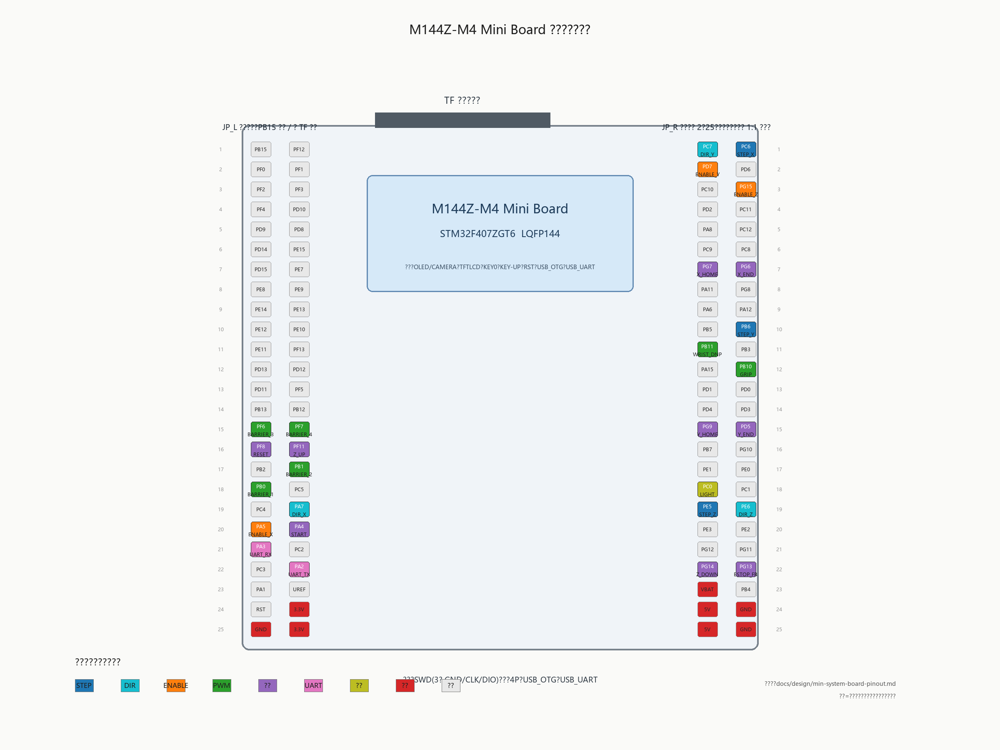



# M144Z-M4 Mini Board 排针记录

> 来源：用户 2026-08-13 手工抄录板面丝印；右侧排针补充 PA6/PA12 行（用户更正：两边都是 25 行）。
> 状态：候选，未冻结。板面布局：上边 TF 卡，左边双排排针（JP_L），右边双排排针（JP_R），下边为 SWD/调试等接口。JP_L 方向已确认：第 1 行（PB15/PF12）靠近 TF 卡端，PB15 为外列（靠板边）、PF12 为内列；JP_R 方向已按用户确认：第 1 行（PC6/PC7）靠近 TF 卡端，PC6 为外列（靠板边）、PC7 为内列；仍建议 1:1 打印核对一次。
> 本文档编号：每行两列为双排两列，行号从靠近 TF 卡端起。

## 1 左侧排针 JP_L（2×25）

| 行 | 外列 | 内列 | 针号(外/内) |
|---|---|---|---|
| 1 | PB15 | PF12 | 1/2 |
| 2 | PF0 | PF1 | 3/4 |
| 3 | PF2 | PF3 | 5/6 |
| 4 | PF4 | PD10 | 7/8 |
| 5 | PD9 | PD8 | 9/10 |
| 6 | PD14 | PE15 | 11/12 |
| 7 | PD15 | PE7 | 13/14 |
| 8 | PE8 | PE9 | 15/16 |
| 9 | PE14 | PE13 | 17/18 |
| 10 | PE12 | PE10 | 19/20 |
| 11 | PE11 | PF13 | 21/22 |
| 12 | PD13 | PD12 | 23/24 |
| 13 | PD11 | PF5 | 25/26 |
| 14 | PB13 | PB12 | 27/28 |
| 15 | PF6 | PF7 | 29/30 |
| 16 | PF8 | PF11 | 31/32 |
| 17 | PB2 | PB1 | 33/34 |
| 18 | PB0 | PC5 | 35/36 |
| 19 | PC4 | PA7 | 37/38 |
| 20 | PA5 | PA4 | 39/40 |
| 21 | PA3 | PC2 | 41/42 |
| 22 | PC3 | PA2 | 43/44 |
| 23 | PA1 | UREF | 45/46 |
| 24 | RST | 3.3V | 47/48 |
| 25 | GND | 3.3V | 49/50 |

## 2 右侧排针 JP_R（2×25，含 PA6/PA12 行）

| 行 | 外列 | 内列 | 针号(外/内) |
|---|---|---|---|
| 1 | PC6 | PC7 | 1/2 |
| 2 | PD6 | PD7 | 3/4 |
| 3 | PG15 | PC10 | 5/6 |
| 4 | PC11 | PD2 | 7/8 |
| 5 | PC12 | PA8 | 9/10 |
| 6 | PC8 | PC9 | 11/12 |
| 7 | PG6 | PG7 | 13/14 |
| 8 | PG8 | PA11 | 15/16 |
| 9 | PA12 | PA6 | 17/18 |
| 10 | PB6 | PB5 | 19/20 |
| 11 | PB3 | PB11 | 21/22 |
| 12 | PB10 | PA15 | 23/24 |
| 13 | PD0 | PD1 | 25/26 |
| 14 | PD3 | PD4 | 27/28 |
| 15 | PD5 | PG9 | 29/30 |
| 16 | PG10 | PB7 | 31/32 |
| 17 | PE0 | PE1 | 33/34 |
| 18 | PC1 | PC0 | 35/36 |
| 19 | PE6 | PE5 | 37/38 |
| 20 | PE2 | PE3 | 39/40 |
| 21 | PG11 | PG12 | 41/42 |
| 22 | PG13 | PG14 | 43/44 |
| 23 | PB4 | VBAT | 45/46 |
| 24 | GND | 5V | 47/48 |
| 25 | GND | 5V | 49/50 |

## 3 板载接口与占用

- 正面：OLED/CAMERA、TFTLCD、KEY0、KEY-UP、RST、USB-OTG、USB-UART。
- 顶部：TF-CARD（SDIO：PC8-PC12、PD2 等，使用 TF 时不可占用）。
- 下方：SWD 排针（GND、CLK、DIO，即 SWCLK/SWDIO）；白色 4P 插座（用途待确认）；USB_OTG（PA11/PA12）；USB_UART（CH340，PA9/PA10）。
- 板载按键占用：KEY-UP（PA0/WK_UP 可能）与 KEY0（GPIO 待确认）；载板不使用这些针。
- PA13/PA14 仅出现在 SWD 排针，不在主排针上；载板不占用。

## 4 待确认

1. JP_R 方向已按用户确认：第 1 行 PC6/PC7 靠近 TF 卡端、PC7 为内列；仍建议 1:1 打印核对一次。
2. UREF 的确切含义（VREF？）。
3. 白色 4P 插座定义。
4. KEY0/KEY-UP 对应 GPIO，避免载板误接。
5. 3.3V/5V/GND 排针可提供给载板的最大电流（随板载 LDO 和输入方式变化）。
