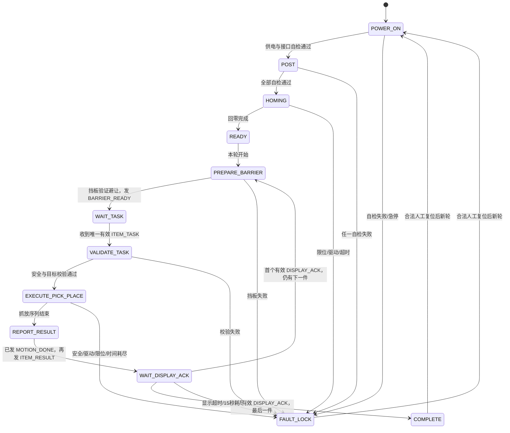

# STM32 状态机与伪代码（方案 B）

> 状态：设计基线；版本：V0.2；日期：2026-08-12  
> 范围：仅定义 STM32F407 的底层运动与安全决策。树莓派负责视觉、任务编排、显示渲染和计数展示；STM32 不接收视觉原始数据、不执行显示渲染，也不把运动控制下放给其他节点。

## 1. 目标、边界与验收

**事实（既定边界）**：校赛实施方案 B；STM32 是唯一可控制执行器运动和安全停机的节点。`MOTION_DONE` 仅说明运动序列结束，`ITEM_RESULT(SUCCESS)` 才是本件成功；下一件必须等到本件首个有效 `DISPLAY_ACK`。

**本模块目标**：以硬件无关的接口表达上电、自检、回零、挡板避让、单件抓放、结果上报、显示确认、故障锁定和人工复位的不可绕过顺序。

**最小验收**：状态转换中不存在“重复运动”“自动跳件”“复位继续旧件”路径；故障、过时/重复帧、显示超时和 15 秒耗尽均有可观察的安全结果。

**未决参数**：各轴数量、行程、速度/加速度、限位类型、超时时间、通信帧的精确字节结构和执行器型号均不在本文决定。所有位置与时长阈值均以配置和已验证机械接口提供。

## 2. 硬件无关抽象接口

所有调用必须返回 `OK` 或带原因的 `FAIL(code)`；不得在伪代码中出现引脚号、PWM 参数、驱动器型号或运动学模型。

```text
type Result = OK | FAIL(FaultCode)
type AxisId, Target, TaskId, FrameSeq, ProgressToken

interface AxisDriver {
  selfTest() -> Result
  enable() -> Result
  disable() -> Result
  home(axis: AxisId) -> Result
  moveTo(target: Target) -> Result
  stopAll() -> Result
  pollProgress() -> OK(ProgressToken) | FAIL(FaultCode)
  driverFault() -> Optional<FaultCode>
}

interface ServoBarrier {
  selfTest() -> Result
  moveToAvoidPosition() -> Result
  isAvoidPositionVerified() -> bool
  holdSafe() -> Result
}

interface Gripper {
  selfTest() -> Result
  open() -> Result
  close() -> Result
  holdSafe() -> Result
}

interface LimitInput {
  selfTest() -> Result
  isTriggered(axis: AxisId) -> bool
  hasFault() -> Optional<FaultCode>
}

interface SafetyPower {
  selfTest() -> Result
  emergencyStopActive() -> bool
  canPermitActuatorPower() -> bool
  actuatorPowerPermitted() -> bool
  inhibitActuatorPower() -> Result
  permitActuatorPower() -> Result
}
```

`SafetyPower.canPermitActuatorPower()` 只表示急停、联锁和供电链满足“允许尝试接通”的前置条件，即使当前动力仍被禁止也可以为真；`actuatorPowerPermitted()` 只表示软件已成功建立本轮动力许可，不冒充物理电压测量或安全触点反馈。`inhibitActuatorPower()` 表示请求安全回路禁止危险执行器动力；真正的急停硬切断必须独立于软件。逻辑供电可保留以便记录故障。任何接口失败都不是可忽略告警，而是进入 `FAULT_LOCK` 的原因。

## 3. 外部事件与幂等规则

| 事件/消息 | 接受状态 | 强制规则 |
|---|---|---|
| `ITEM_TASK(taskId, frameSeq, target)` | `WAIT_TASK`，且已收到本轮 `BARRIER_READY` | STM32 只保留一个 `activeTask`；只接受任务号匹配当前轮、序号新且目标有效的一件任务。其他任务不排队。 |
| 重复 `ITEM_TASK` | 任意状态 | 若 `(taskId, frameSeq)` 已处理，重发原 ACK/最后状态，绝不再次抓放或重新计数。 |
| 旧轮、旧序号、乱序 `ITEM_TASK` | 任意状态 | 丢弃并记录；不改变 `activeTask`、执行器或 15 秒基准。若同一任务号载荷冲突，进入 `FAULT_LOCK`。 |
| `DISPLAY_ACK(taskId, frameSeq)` | `WAIT_DISPLAY_ACK` | 仅接受与已完成本件一致、未消费、序号新且显示内容校验通过的首帧；重复 ACK 仅重发状态。 |
| `MANUAL_RESET` | `FAULT_LOCK` 或 `COMPLETE` | 仅在本轮已结束、人工确认危险区清空且急停已释放后接受；不能恢复或续跑旧 `activeTask`。 |

`BARRIER_READY(taskId/round)` 由 STM32 在挡板已实际到达并验证避让位后发出，不能仅因已下发舵机命令而发出。STM32 在本轮只允许一个未结案件：从接受 `ITEM_TASK` 到消费首个有效 `DISPLAY_ACK` 前，所有新任务均拒绝。

## 4. 状态机



`READY` 只表示回零完成；`WAIT_TASK` 是“接收恰好一件”的门。每一件重新进入 `PREPARE_BARRIER`，因此下一件永远不会绕过挡板避让和新一次 `BARRIER_READY`。

## 5. 15 秒可观察进度规则

每轮维护 `lastObservableAt` 与 `deadline = lastObservableAt + 15 s`。本轮开始时以 `roundStart` 初始化两者。计时不因心跳、日志、任务 ACK/NACK、CRC 重传、视觉重询、显示数据重发、重复 `DISPLAY_ACK` 或状态查询而延长。

实现必须使用不受日期校时、网络时间或人工设置影响的单调时钟，并采用溢出安全的时间差比较；具体使用系统节拍还是独立硬件定时器、计数分辨率与误差预算，须由固件平台测试后冻结，本文不预设数值。

仅下列事件可更新 `lastObservableAt`，并据此更新 15 秒失动截止时间：

1. `AxisDriver.pollProgress()` 返回了相对于上一个 `ProgressToken` 的、已验证的实际运动进度；
2. 当前件等待显示时，收到**首个**通过任务号、序号与渲染内容校验的 `DISPLAY_ACK`。

`deadline` 到期、运动长时间无新的可观察进度，或显示确认剩余时间不足时，都调用 `fault(ROUND_TIME_EXHAUSTED)`；不得自动跳过该件。重传、重询与重复刷新不能更新基准，因此不能借由它们延长本轮。

## 6. 主循环伪代码

```text
state = POWER_ON
activeTask = NONE
acceptedFrameCache = {}              // 有界缓存：(taskId, frameSeq) -> response
displayAckConsumed = false

loop forever:
  if SafetyPower.emergencyStopActive():
    fault(ESTOP_ACTIVE)

  if state in {HOMING, READY, PREPARE_BARRIER, WAIT_TASK, VALIDATE_TASK,
               EXECUTE_PICK_PLACE, REPORT_RESULT, WAIT_DISPLAY_ACK}
     and not SafetyPower.actuatorPowerPermitted():
    fault(ACTUATOR_POWER_PERMISSION_LOST)

  if LimitInput.hasFault() or AxisDriver.driverFault():
    fault(REPORTED_HARDWARE_FAULT)

  if now() >= deadline and state not in {POWER_ON, POST, HOMING, READY, COMPLETE, FAULT_LOCK}:
    fault(ROUND_TIME_EXHAUSTED)

  switch state:
    case POWER_ON:
      clearRoundVolatileState()
      if SafetyPower.selfTest() and SafetyPower.inhibitActuatorPower() and
         AxisDriver.selfTest() and ServoBarrier.selfTest() and
         Gripper.selfTest() and LimitInput.selfTest():
        state = POST
      else: fault(POST_FAILED)

    case POST:
      if SafetyPower.emergencyStopActive() or not SafetyPower.canPermitActuatorPower():
        fault(POWER_NOT_SAFE)
      else if SafetyPower.permitActuatorPower():
        if SafetyPower.actuatorPowerPermitted(): state = HOMING
        else: fault(POWER_PERMISSION_NOT_CONFIRMED)
      else: fault(POWER_ENABLE_FAILED)

    case HOMING:
      for each configured axis:
        require(AxisDriver.home(axis))
        require(not unexpectedLimitDuringHome(axis))
      require(Gripper.open())
      require(ServoBarrier.holdSafe())
      beginNewRoundDeadline(15 seconds)
      state = READY

    case READY:
      if roundStartCommandAccepted(): state = PREPARE_BARRIER

    case PREPARE_BARRIER:
      require(ServoBarrier.moveToAvoidPosition())
      require(ServoBarrier.isAvoidPositionVerified())
      emit(BARRIER_READY, currentRound)
      state = WAIT_TASK

    case WAIT_TASK:
      frame = receiveFrame()
      if frame is none: continue
      if isDuplicate(frame): resendCachedResponse(frame); continue
      if isOldOrOutOfOrder(frame): logDrop(frame); sendNack(frame, STALE_OR_ORDER); continue
      if frame.type != ITEM_TASK: sendNack(frame, UNEXPECTED_MESSAGE); continue
      if activeTask != NONE: sendNack(frame, SINGLE_TASK_ONLY); continue
      activeTask = frame.task
      cacheAck(frame, ACCEPTED)
      state = VALIDATE_TASK

    case VALIDATE_TASK:
      require(not SafetyPower.emergencyStopActive())
      require(SafetyPower.actuatorPowerPermitted())
      require(ServoBarrier.isAvoidPositionVerified())
      require(targetIsWithinConfiguredSafeWorkspace(activeTask.target))
      require(taskHasValidIdentityAndOrder(activeTask))
      state = EXECUTE_PICK_PLACE

    case EXECUTE_PICK_PLACE:
      // 每个 executeStep 内部在实际运动期间 pollProgress()；仅新 ProgressToken 调用 markObservableProgress()。
      executeStep(AxisDriver.moveTo(activeTask.pickApproach))
      executeStep(AxisDriver.moveTo(activeTask.pick))
      executeStep(Gripper.close())
      executeStep(AxisDriver.moveTo(activeTask.safeTransfer))
      executeStep(AxisDriver.moveTo(activeTask.placeApproach))
      executeStep(AxisDriver.moveTo(activeTask.place))
      executeStep(Gripper.open())
      executeStep(AxisDriver.moveTo(configuredSafeHomePose))
      state = REPORT_RESULT

    case REPORT_RESULT:
      emit(MOTION_DONE, activeTask.id)       // 仅运动序列结束，不更新成功数
      result = determineItemResultFromCompletedControlSequence(activeTask)
      emit(ITEM_RESULT, activeTask.id, result)
      // 只有 result == SUCCESS 的 ITEM_RESULT 可被上层计入成功数。
      displayAckConsumed = false
      state = WAIT_DISPLAY_ACK

    case WAIT_DISPLAY_ACK:
      frame = receiveFrame()
      if frame is none: continue
      if isDuplicate(frame): resendCachedResponse(frame); continue
      if not isFirstValidDisplayAck(frame, activeTask, displayAckConsumed):
        sendNack(frame, ACK_NOT_APPLICABLE); continue
      displayAckConsumed = true
      markObservableProgress("initial_valid_display_ack")
      cacheAck(frame, ACK_CONSUMED)
      finalizeItemWithoutReplayingMotion(activeTask)
      activeTask = NONE
      state = hasNextItemDeclaredForThisRound() ? PREPARE_BARRIER : COMPLETE

    case COMPLETE:
      AxisDriver.disable(); ServoBarrier.holdSafe(); Gripper.holdSafe()
      if manualResetPermitted(): state = POWER_ON

    case FAULT_LOCK:
      holdFaultLock()
      if manualResetPermitted(): state = POWER_ON
```

`require(x)` 与 `executeStep(x)` 在收到 `FAIL` 时立即调用 `fault(code)`，不继续后续动作。每个 `moveTo()` 执行期间必须轮询限位、急停、驱动故障、截止时间和可观察运动进度；任何异常都在该动作中止后锁定。

## 7. 故障锁定与恢复闸门

```text
function fault(code):
  AxisDriver.stopAll()                 // 立即停止脉冲/运动请求
  AxisDriver.disable()                 // 关闭相关驱动使能
  ServoBarrier.holdSafe()
  Gripper.holdSafe()
  SafetyPower.inhibitActuatorPower()   // 急停时还必须已有独立硬件切断
  emit(ERROR, code, activeTask.id if any)
  clearPendingCommandsExceptAuditLog()
  state = FAULT_LOCK

function manualResetPermitted() -> bool:
  return state in {FAULT_LOCK, COMPLETE}
     and currentRoundIsEndedAndLogged()
     and not SafetyPower.emergencyStopActive()
     and operatorPhysicalInspectionConfirmed()
     and noActiveTaskCanBeResumed()
```

恢复只允许“结束本轮 → 人工检查 → 重新上电自检 → 回零 → 新任务号的新轮”。不得自动回零、自动重抓、重放已完成运动、重复投放、跳过当前件，或把通信/显示重传伪装成恢复。运动前视觉复核、运动中通信重传、运动后同件显示刷新均可在其原阶段有限执行，但绝不重置 15 秒截止时间，且耗尽后仍进入 `FAULT_LOCK`。

## 8. 故障与验证场景

| 场景 | 注入/判定 | 预期 STM32 行为 | 通过证据 |
|---|---|---|---|
| 急停 | `emergencyStopActive=true`，任意运动阶段 | 硬件切危险动力；软件停止脉冲、禁用驱动、锁定；释放急停后不自启 | 无后续运动命令；仅人工复位可新开轮 |
| 限位异常 | 回零外触发限位，或限位自检失败 | 停止并锁定，不尝试反向“碰碰运气” | `ERROR(LIMIT_*)`，没有后续抓放 |
| 驱动故障 | `driverFault()` 返回故障 | 停脉冲、禁能、锁定 | 故障日志及无 `MOTION_DONE`/成功结果 |
| 帧丢失 | 运动中丢失可重传响应帧 | 只在原动作仍安全且时间未耗尽时重传协议响应；不重放运动 | 同一件无第二次 `moveTo` 序列 |
| 重复帧 | 重发已处理 `ITEM_TASK` 或 `DISPLAY_ACK` | 重发缓存响应；不重复抓放/不二次消费 ACK | 执行器调用计数不增加 |
| 旧帧/乱序帧 | 旧轮、旧序号、任务号冲突 | 丢弃或 NACK；任务号冲突锁定 | `activeTask` 不变；冲突有故障记录 |
| 显示确认超时 | `WAIT_DISPLAY_ACK` 未收到首个有效 ACK | 保持已完成动作，不重放投放；时间耗尽后锁定 | 无新任务被接受，无重复 `MOTION_DONE` |
| 15 秒耗尽 | 截止时间到，或只有重传/日志等非可观察活动 | `ROUND_TIME_EXHAUSTED` 锁定；禁止自动跳件 | 时间线显示 deadline 未被重置 |
| 人工复位 | 故障未结束本轮、急停未释放，或试图恢复旧任务 | 拒绝复位 | NACK/日志；无动力恢复 |
| 合法人工复位 | 本轮已结束、急停释放、现场确认完成 | 从 `POWER_ON` 重走自检与回零，生成新轮上下文 | 旧 `taskId` 无法再次执行 |

## 9. 实施前检查清单

- [ ] 将 `Target` 的安全工作区、轴回零顺序、挡板“验证到位”判据交由机械接口确认；本文不替代该确认。
- [ ] 将 `ITEM_TASK`、`DISPLAY_ACK` 的任务号、序号、载荷校验和缓存窗口冻结到通信契约。
- [ ] 用接口替身执行上表注入测试，记录状态转移、接口调用和事件日志。
- [ ] 验证急停的危险动力硬切断和重力轴断电防坠，不能只测软件分支。
