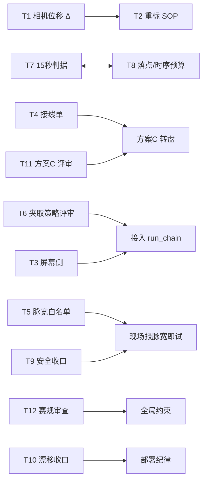

# 多 AI 并行派工包 · 2026-09-20 · 总控索引

> **总控**：DSH（DeepSeek Harness，本会话）。
> **你（用户）是唯一的信使**：我不自动派发，你把 `01`~`06` 每个文件**整段复制**贴给对应 AI。
> **平级原则**：六个 AI 之间互不为下属，各自独立产出；我只做「召集 + 汇总 + 交叉核验」，不做指挥。

---

## 〇、并行安全与只读强制（**最重要的一条**）

### 结论：只读可以并行，写文件绝对不行

| | 并行安全吗 | 原因 |
|---|---|---|
| **只读**（读代码、读文档、推理） | ✅ **完全安全** | 并发读不会冲突，6 个会话同时读同一份文件没有任何问题 |
| **写文件** | 🔴 **绝对禁止** | 两个会话同时写，**后写的把先写的吃掉，而且不报错**——会在几小时后才发现仓库变成四不像 |

⇒ 本包的 12 项任务**全部设计为只读**，彼此不重叠 ⇒ 可以并行。
**但「只读」不能只靠提示词里写一句话**：AI 会「顺手」建笔记、跑测试（跑测试就会生成
`__pycache__` / `.pytest_cache`，**那也是写文件**）。必须**工具层 + 提示词层两道锁**。

### 锁 1 · 工具层（最有效，启动时就加参数）

| 会话 | 强制只读的做法 | 风险 |
|---|---|---|
| **会话 A**（默认 Claude） | 只读模式启动；Claude Code 用 **plan mode**，或只放行 `Read / Grep / Glob` | 🔴 有写权限，**必须加** |
| **会话 B**（模型不限） | 同上：能读文件 ≠ 可以写文件 | 🔴 有写权限，**必须加** |
| **DeepSeek** | — | 🔴 有读权限，**按只读执行** |
| **豆包** | — | 🔴 有读权限，**按只读执行** |
| **Grok** | — | 🔴 有读权限，**按只读执行** |
| ~~Codex / ChatGPT~~ | 已下线 | — |

### 锁 2 · 提示词层（已内置进 `01`~`06` 全部六份）

每份提示词里都插入了 `## 【🔴 输出落点：只准写在回复里，禁止碰我任何一个文件】`，
并声明**该条优先于提示词里其它一切要求**。要点：

1. 禁止创建/修改/删除/移动/重命名**任何**文件（含新建 `.md`/`.txt`/笔记/待办/草稿），**没有例外**。
2. 禁止执行**任何会产生文件的命令**：不跑测试、不编译、不格式化、不 `pip install`、
   不动 `__pycache__` / `.pytest_cache` / `build/`。
3. 全部产出**写在回复正文里**，代码块包裹，前面先写一行
   `[落点] 目标文件：<相对路径> ｜ 方式：整体新建/整体替换/替换 :起-止 行 ｜ 语言：<x>`。
4. 不许自己跑验证，改成写 `[建议执行] <完整命令>`，**由我（总控）串行统一执行并回填**。
5. 能切只读模式就先切。
6. **偏离自报**：真写了文件必须如实列出完整路径——**隐瞒比犯错严重得多**。
7. 回执头新增自报字段：`文件写入: 无（我只读，一个文件都没碰）`。

### 我的落盘纪律（总控侧）

- **在所有 6 个 AI 全部回来、我比对完冲突之前，我不写任何代码/配置文件。**
- 只有等汇总完成、你裁决完分歧，我才**一份一份串行**落盘，每写一份就跑一次最小验证。
- 落盘前先看 `docs/交付/2026-09-20/改动与风险台账-2026-09-20.md` 的回滚路径。

### 顺带说明为什么这样最省

6 个会话各自「边想边改」的写法，最后必然要人肉合并 6 份互相冲突的改动；
改成「全部产出文本 + 总控串行落盘」之后，合并成本从「解冲突」降成「挑要哪几条」。

---

## 一、分工表（优势错开，不重复劳动）

| 文件 | 派给 | 任务 | 为什么是它 | 你要附什么材料 |
|---|---|---|---|---|
| `02a-会话A-T6-T9-T11-评审官.md` | **会话 A**（默认 Claude） | T6 夹取策略接入前评审 + T9 硬件安全收口 + T11 方案C 草案评审 | 找漏洞/边界/fail-closed 最强 | 不用（本机可直读） |
| `02b-会话B-T5-T3-固件与屏幕.md` | **会话 B**（模型不限，再开一个窗口） | T5 台架脉宽白名单补丁 + T3 屏幕侧问题 | 读源码出 diff | 不用（本机可直读） |
| `03-DeepSeek-T7-T8-时序与语义.md` | **DeepSeek** | T7 「15 秒没看到能抓的⇒结束本轮」+ T8 落点与时间预算复核 | 纯逻辑推理 + 公式复算，不需要文件 | 不用；可选附 `run_chain.py` 全文 |
| `04-豆包-T12-T2-赛规与流程.md` | **豆包** | T12 赛规符合性审查（新）+ T2 搬相机后重标 SOP | 中文长文档/PDF 理解强 | ⚠️ **必须附**：`27年工创.pdf` 第 9–13 页 + 四川省赛细则 PDF |
| `05-Grok-T1-T4-接线单.md` | **Grok** | T1 相机位移几何核算 + T4 转盘接线单（PWM 扩展板路线） | 联网查手册/规格最强；T1 参数已内嵌不需文件 | T1 不用附件；T4 可选附 PCA9685 板照片、`FC-SPX303Z.pdf` |
| — | **DSH（我）** | **T10** 仓库↔现场漂移收口 + 68 个 `pi_*.py` 危险分级，以及全部汇总 | 本机+ssh 证据核验是我的强项 | 我自查，不问你要 |

**覆盖度**：T1–T12 共 12 项 + T10 我自做 = **13 条工作流，全部有主，无重叠、无遗漏。**

> 与旧文件 `派工提示词-2026-09-20-十问题分工.md` 的关系：那份是**按任务**分的（T1–T11，内容仍是权威口径）；这份是**按 AI** 重的（新增 T12 赛规审查）。两者口径一致，本包为准。

---

## 二、并行性

**13 条全部可以同时开工**，没有硬阻塞：



- `T1 → T2` 只是**精度依赖**：T2 的 SOP 把 Δ 当参数写，等 T1 出数再代入即可，不必串行等。
- `T7 ↔ T8` 互相影响（15 秒逻辑 vs 单件时序预算）⇒ 我故意**给了同一个 AI（DeepSeek）**，保证口径自洽。
- `T6 / T11` 都是「批准前评审」，不阻塞别人。

---

## 三、统一回执格式（已在每个提示词末尾内嵌）

每个 AI 必须以下面这个头开场，我靠它机器化汇总：

```
=== 回执 ===
AI: <名字>
任务号: <T#>
状态: 完成 / 部分完成 / 卡住
置信度: 1-5
证据缺失项: <n 条>
逻辑跳跃项: <n 条>
我改动过的文件: 无 / 列表
=== 正文 ===
```

然后正文固定五段：①结论 ②证据 ③方案/补丁 ④待现场确认项 ⑤下一步。

---

## 四、红线（已写进每个提示词）

1. 禁止一切 **git** 操作。
2. 禁止任何**实机动作**（接线/上电/烧录/发串口/跑链），除非用户当面对该次动作明确授权。
3. **只读调查 + 出文档/diff 文本**；不要改任何文件（出 diff ≠ 应用 diff）。
4. 每个断言必须带 `文件:行号` 或原始命令输出；**事实与推断分开标注**；禁止把离线结论说成实机结论。
5. 不确定写「证据不足」，**绝不允许编造数值**。
6. 上电/复位前必须先把滑台推到最内侧负角顶住（固件在复位那一刻把当前位置认定为 HOME，不做寻零运动）；顺序错 → 顶死堵转（已发生 3 次）。
7. X/Y 无限位、无编码器，可达域**非对称**：X ∈ [-95.0, +90.0]、Y ∈ [-97.5, +92.5] mm。
8. 树莓派上 68 个 `pi_*.py` 里 12 个会写串口/发运动，**跑链期间绝不要跑**。

---

## 五、回收与第二轮（我做的事）

1. **收齐**：你把这六个 AI 的回复贴回给我（或存成 `回复-<AI名>.md` 丢进本目录），我逐条比对。
2. **交叉核验**：我只对**高风险结论**做轻量抽查（数值复算、行号回查），不重读每个字。
3. **分歧处理**：若两个 AI 结论冲突，我各留一句「分歧声明」（依据 + 替代方案）交你裁决，**不强行融合**。
4. **第二轮对抗复核**：模板见 `99-总控汇总与第二轮复核模板.md`——把 A 的产出交给 B 挑错，专门抓「看起来对但其实反例存在」的结论。
5. **落盘**：汇总结果写入 `docs/交付/2026-09-20/多AI并行-汇总-2026-09-20.md`（我来写），并更新 `当前进度与交接.md`。

---

## 六、你现在要做的事（按顺序）

1. 开 **5 个会话**：
   - **会话 A**（默认 Claude）→ 贴 `02a-会话A-T6-T9-T11-评审官.md`
   - **会话 B**（模型不限，再开一个窗口）→ 贴 `02b-会话B-T5-T3-固件与屏幕.md`
   - **DeepSeek** → 贴 `03-DeepSeek-T7-T8-时序与语义.md`
   - **豆包** → 贴 `04-豆包-T12-T2-赛规与流程.md`
   - **Grok** → 贴 `05-Grok-T1-T4-接线单.md`
2. **所有会话都按只读执行**（见 §〇 锁 1）——**能读文件 ≠ 可以写文件**。
3. **豆包那条务必先把两份赛规 PDF 附上**，否则 T12 只能做一半。
4. 五份回复回来后，把回复贴回本会话给我。
5. 期间不用等我——**T10 我自己在做**。

> 🔴 `_下线-01-Codex-*.md` 与 `_下线-06-ChatGPT-*.md` **不要发送**：
> 里面的任务已全部转出，误发会造成重复劳动。留着只为 Codex / ChatGPT 恢复后复用。

---

## 七、变更记录

| 时间 | 变更 | 原因 |
|---|---|---|
| 2026-09-20 | 初版：6 个 AI 并行（Codex / Claude / DeepSeek / 豆包 / Grok / ChatGPT） | 用户要求全面并行 |
| 2026-09-20 | 六份提示词统一插入「🔴 输出落点」只读条款 + 回执自报字段 | 多会话共用同一工作目录，**并发写会静默互相覆盖** |
| 2026-09-20 | **Codex、ChatGPT 下线**：T5→Claude-B，T9→Claude-A，T1→Grok，T3→Claude-B | 两个会话打不开 |
| 2026-09-20 | 改为**双 Claude 会话**（A/B），总控 DSH **退回纯汇总 + T10** | 用户选择「多开对话」 |
| 2026-09-20 | 修正：**各 AI 均可读本地文件**，删去「网页版无文件权限」的错误说明 | 用户澄清 |
| 2026-09-20 | 新增**派工前工作区快照**（`工具/快照校验.py`），派工后 `--diff` 可证明各 AI 有没有写盘 | 把「不要改我的文件」从请求变成可验证 |
| 2026-09-20 | **定稿：按各模型优势极限分配**（见 §八） | 用户要求「把每个模型的能力和优势发挥到极致」 |

---

## 八、按模型优势的最终分配（定稿）

**原则：一件事只派给「做这件事最强」的那一个会话，不做对称分配、不做互补冗余。**
提示词本身是**模型无关**的（自包含 + 只读条款），所以下面的指派是**推荐**，不是硬绑定。

| 模型 | 窗口 | 任务 | 为什么是它（用它的哪项长处） |
|---|---|---|---|
| **Claude** | 窗口 1 | T6、T9、T11 | **长上下文代码精读 + 找漏洞**。这三件都是「读已写好的代码/设计 → 找出它哪里会坏」：T6 判航点可表达性、T9 判 fail-open 安全缺口、T11 判零位误差累积。Claude 最擅长长链符号推理 + 主动构造反例 |
| **Claude** | 窗口 2 | T5、T3 | **逐行读码 → 出严谨 unified diff**。T5 要把两张散落的脉宽白名单收敛成一张并修 HELP；T3 要在 700+ 行屏幕代码里定位「字体自相矛盾」的根因。都是**精确到行号的代码手术** |
| **DeepSeek** | 1 个 | T1、T7、T8 | **数理复算 + 语义边界定义**。T1 是旋转正方形对不规则区域的最大覆盖（二维最优化）；T7 要定义「15 秒没看到能抓的」的 2~3 种语义并推演各自的反例；T8 是纯公式复算。全都是「把定义写严密、把数字算准」 |
| **豆包** | 1 个 | T12、T2 | **中文长文档 / PDF 精读 + 流程化输出**。T12 要逐条锚到赛规原文页码条款（别人容易凭印象写）；T2 要产出「不懂视觉标定的人也能照做」的中文 SOP |
| **Grok** | 1 个 | T4 | **实时联网检索 + 多源交叉核实**。T4 的每个数字（舵机堵转电流、PCA9685 那一路的额定电流、光电开关输出类型）都必须落到官方手册链接；查不到就写「未查到」，这是 Grok 的独占优势 |
| **DSH（我）** | — | T10 + 汇总 | **本机 + ssh 证据核验、编排、交叉复核**。漂移表要双向 md5、68 个脚本要分级、六份回复要合并去冲突 |

### 为什么这样切最省

- **没有人读重复的文件**：Claude 读 `pick_strategy/`、`firmware/`、`方案C草案`；DeepSeek 只读提示词里内嵌的数（不读代码）；豆包读 PDF；Grok 读网页；我读仓库与树莓派。
- **没有人在同一个坐标系上重复推理**：T7/T8 互相耦合 ⇒ 同一个会话（DeepSeek），强制口径自洽。
- **每个任务都落在唯一一个「最强的会话」上**，不做「两个模型都做一遍再比对」——那是浪费额度，不是发挥优势。

### 任务负载

Claude 5 件（拆两个窗口，各 2~3 件）｜ DeepSeek 3 件 ｜ 豆包 2 件 ｜ Grok 1 件 ｜ 我 2 件 + 汇总。

> Grok 只有 1 件，是因为本项目**唯一需要联网核实**的就是 T4。若你愿意，可以再开一个 Grok 窗口把它当第二个「独立复算者」——但那属于冗余复核，等第二轮对抗复核（见 `99`）时再用更合适。

---

## 九、七窗口定稿（2026-09-20 修订 · **取代 §八**）

Codex 与 ChatGPT 恢复可用后重排。**7 个窗口，每窗一个任务簇，零重叠。**

| 窗口 | 模型 | 任务 | 用它的哪项长处 |
|---|---|---|---|
| 1 | **Claude** | T6 + T11 | 长上下文代码精读 + 主动构造反例 |
| 2 | **Claude** | T3 + T13 | 树莓派侧 Python 逐行读码 → 出可运行代码与 diff |
| 3 | **DeepSeek** | T7 + T8 | 语义边界定义 + 数理复算 |
| 4 | **豆包** | T12 + T2 | 中文 PDF 精读 + 流程化 SOP |
| 5 | **Grok** | T4 | 实时联网查手册、交叉核实规格 |
| 6 | **ChatGPT** | T1 | **代码解释器**真跑多边形求交算覆盖面积 |
| 7 | **Codex** | T5 + T9 | 本机固件 C + 可编译级 diff + 逐行核对 |
| — | **DSH（我）** | T10 + 落盘 + 汇总 | 本机 + ssh 证据核验、编排、交叉复核 |

**与 §八 的差异**：
- T1 由 Grok 挪给 **ChatGPT**——多边形求交它是**真算**，不是估算
- T5 / T9 归还 **Codex**（原本就是它的活，且它能做可编译级核对）
- Claude 窗口 2 由「T5+T3」改为「**T3 + T13**」（T13 = 新增的转盘舵机驱动代码）

**文件对照**：
`01` Codex（T5+T9）｜`02a` Claude 窗口 1（T6+T11）｜`02b` Claude 窗口 2（T3）｜`07` T13（**同一窗口接着发**）｜`03` DeepSeek｜`04` 豆包｜`05` Grok（T4）｜`06` ChatGPT（T1）｜`99` 我的工作台

**任务覆盖**：T1–T13 共 13 项，各有唯一归属，无重叠、无遗漏。
（T10 = 仓库↔现场漂移收口，需树莓派上线，我自做。）

